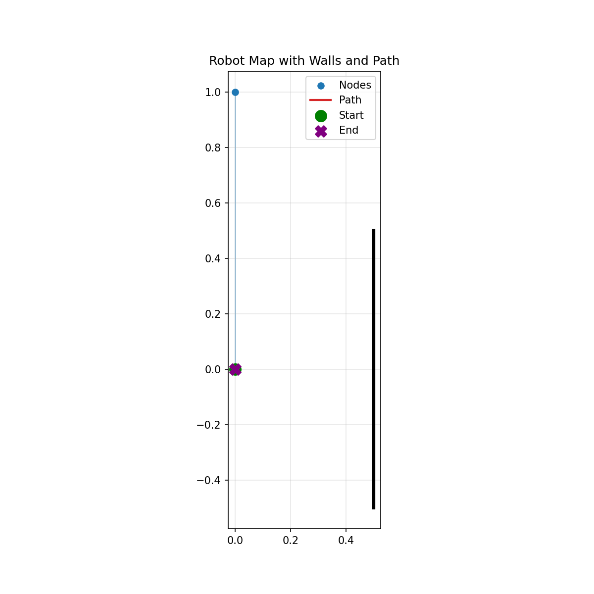
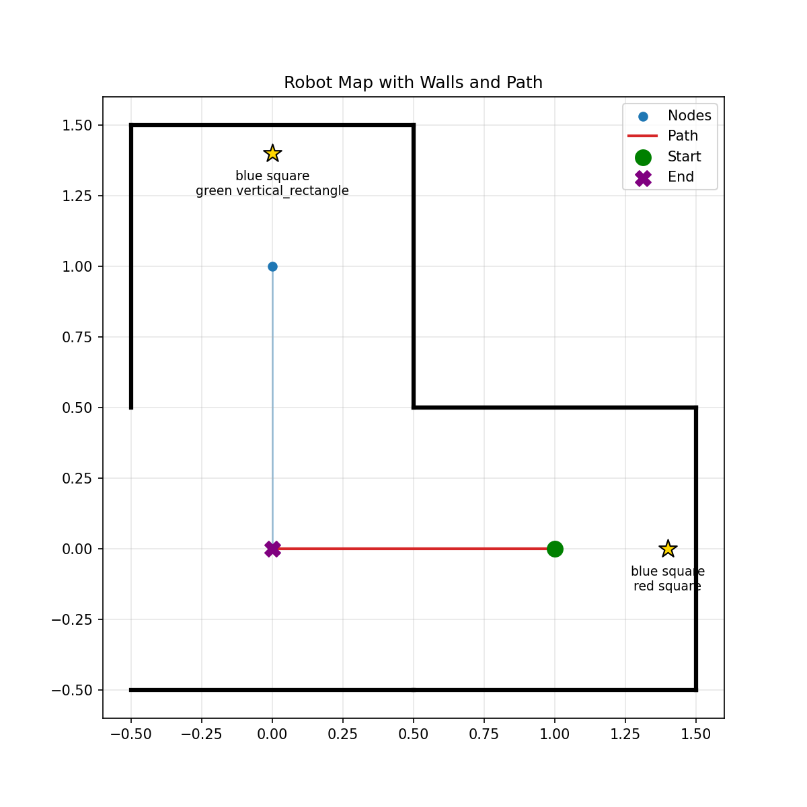

# Autonomous Robot Exploration and Mapping System

An autonomous mobile robotics project focused on environment exploration, path navigation, and map generation. The system explores a maze-like environment, records mapping data, and stores exploration states and target information for analysis and visualization.

## Overview

This project explores autonomous robot navigation and environment mapping using a RoboMaster-based development environment. It focuses on enabling a mobile robot to explore its surroundings, record navigation-related data, and generate visual representations of the explored environment.

The repository includes map images, JSON-based mapping states, target records, and sensor-testing utilities to support development, testing, and analysis.

## Key Features

- **Autonomous Exploration:** Supports robot exploration in a maze-like environment.
- **Environment Mapping:** Generates and stores map representations of the explored area.
- **Navigation Data Logging:** Records mapping states and target information in JSON format.
- **Map Visualization:** Provides visual map outputs for reviewing exploration results.
- **Sensor Testing:** Includes utilities for checking sensors and related robot components.
- **Robotics Integration:** Uses the RoboMaster SDK and Python-based tools for robot development.

## Technology Stack

| Category | Technologies |
|---|---|
| Programming Language | Python |
| Robotics SDK | RoboMaster SDK |
| Computer Vision | OpenCV |
| Numerical Computing | NumPy, SciPy |
| Data Analysis | Pandas |
| Visualization | Matplotlib |
| Data Storage | JSON |

## Project Structure

```text
Autonomous-Robot-Exploration-and-Mapping-System/
├── lab/
├── sensor_check_gimbal/
├── snapshots/
├── test/
├── maze_map.png
├── maze_run2_path.png
├── map_state_run1_*.json
├── targets_run1_*.json
├── requirements.txt
└── README.md
```

- `lab/` — Robotics development and exploration experiments.
- `sensor_check_gimbal/` — Sensor and gimbal testing utilities.
- `snapshots/` — Supporting snapshots and development records.
- `test/` — Testing scripts and experimental code.
- `maze_map.png` — Visual representation of the maze map.
- `maze_run2_path.png` — Visualization of a recorded exploration path.
- `map_state_run1_*.json` — Saved mapping states from exploration runs.
- `targets_run1_*.json` — Recorded target information associated with exploration runs.
- `requirements.txt` — Python dependencies.

## Mapping Visualization

### Maze Map



### Exploration Path



These visualizations provide a reference for examining the environment map and recorded robot path.

## Installation

### Prerequisites

- Python 3
- A compatible RoboMaster robot or development environment
- Network connectivity and robot configuration, when using physical hardware

### 1. Clone the Repository

```bash
git clone https://github.com/diw-nrh/Autonomous-Robot-Exploration-and-Mapping-System.git
cd Autonomous-Robot-Exploration-and-Mapping-System
```

### 2. Create a Virtual Environment

```bash
python -m venv .venv
```

Activate the environment on Windows:

```powershell
.\.venv\Scripts\Activate.ps1
```

On Linux or macOS:

```bash
source .venv/bin/activate
```

### 3. Install Dependencies

```bash
python -m pip install --upgrade pip
pip install -r requirements.txt
```

## Running the Project

The repository contains development scripts in the `lab/` and `test/` directories. The appropriate entry-point script depends on the specific exploration or mapping experiment.

1. Install the required Python dependencies.
2. Configure the RoboMaster development environment and connect the robot if required.
3. Review the scripts in `lab/` and `test/` to identify the intended entry point.
4. Run the appropriate script for the selected experiment.
5. Review generated map images, JSON mapping states, and target records.

**Note:** Exact execution commands depend on the selected script and its configuration. Refer to the source code before running an experiment.

## Applications

- Autonomous mobile robotics
- Maze exploration and navigation
- Environment mapping and visualization
- Robotics software development and testing
- Foundation for more advanced autonomous navigation systems

## Future Improvements

- Implement or improve systematic exploration strategies.
- Integrate localization and mapping algorithms such as SLAM, where appropriate.
- Add obstacle detection and avoidance.
- Evaluate exploration coverage and navigation efficiency.
- Improve map visualization and experiment reproducibility.
- Add a documented end-to-end setup and execution workflow.

## Author

**Diw Naruechit**

GitHub: [@diw-nrh](https://github.com/diw-nrh)

## License

Refer to the repository's license and applicable RoboMaster SDK terms before redistributing the project or its dependencies.
